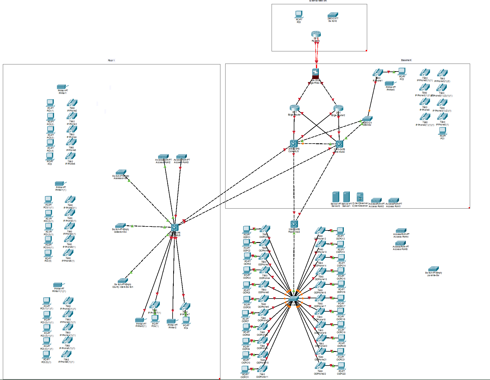
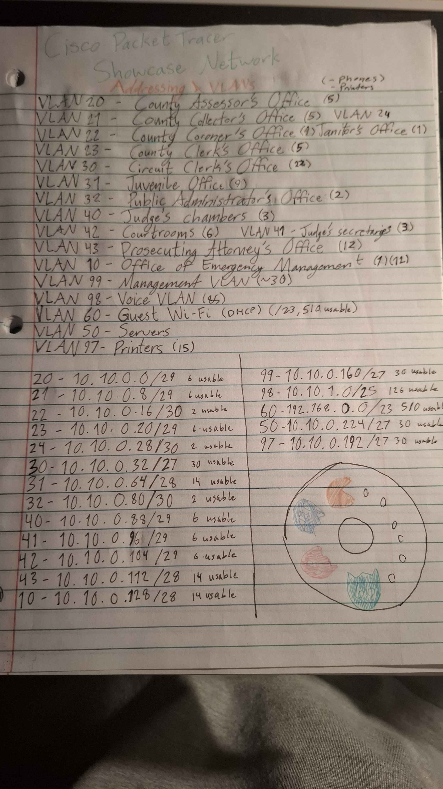

# Enterprise County Courthouse Network Infrastructure

## 📌 Project Overview
This project simulates a secure, three-tier enterprise network for a multi-floor county courthouse using Cisco Packet Tracer. \
It demonstrates hierarchical network architecture, VLAN segmentation, dynamic routing via OSPF, Centralized AAA/RADIUS, QoS, EtherChannel, and basic network device security. \


### Key Features & Technologies
* **Architecture:** Three-Tier (Edge, Core, Distribution/Access)
* **Routing Protocol:** OSPF Area 0 (Single Area)
* **Segmentation:** 15+ Departmental VLANs with VLSM Subnetting
* **Services:** Centralized DHCP , DNS, AAA/RADIUS Authentication, Web Server
* **Security & Control:** Port Security, SSH Management, Native VLAN Isolation, Passive Interfaces

---

## 📐 Network Topology


### Device Roles
* **Edge Router / Firewall:** Handles WAN handoff to ISP, NAT, and outer firewall boundary.
* **`L3Sw-Core`:** Acts as the backbone, facilitating inter-floor traffic and server connections.
* **`L3Sw-2` (Floor 1), `L3Sw-3` (Floor 2), `L3Sw-4` (Floor 3):** Multilayer switches providing local inter-VLAN routing for departmental offices.
* **`L2Sw-1` (Basement):** Layer 2 switch servicing the Office of Emergency Management

---

## 📊 VLAN & IP Subnetting Scheme


| VLAN ID | Subnet Name / Department | Network Address | Subnet Mask | Usable IP Range | Default Gateway |
|:-------:|:-------------------------|:----------------|:-----------:|:----------------|:----------------|
| **10**  | Emergency Management     | 10.10.0.128/28  | 255.255.255.240 | 10.10.0.129 - 10.10.0.142 | 10.10.0.129 |
| **20**  | Assessor's Office        | 10.10.0.0/29    | 255.255.255.248 | 10.10.0.1 - 10.10.0.6     | 10.10.0.1   |
| **21**  | Collector's Office       | 10.10.0.8/29    | 255.255.255.248 | 10.10.0.9 - 10.10.0.14    | 10.10.0.9   |
| **22**  | Coroner's Office         | 10.10.0.16/29   | 255.255.255.252 | 10.10.0.17 - 10.10.0.18   | 10.10.0.17  |
| **23**  | County Clerk's Office    | 10.10.0.20/29   | 255.255.255.248 | 10.10.0.21 - 10.10.0.26   | 10.10.0.21  |
| **24**  | Janitor's Office         | 10.10.0.28/29   | 255.255.255.252 | 10.10.0.29 - 10.10.0.30   | 10.10.0.29  |
| **30**  | Circuit Clerk            | 10.10.0.32/27   | 255.255.255.224 | 10.10.0.33 - 10.10.0.62   | 10.10.0.33  |
| **31**  | Juvenile Office          | 10.10.0.64/28   | 255.255.255.240 | 10.10.0.65 - 10.10.0.78   | 10.10.0.65  |
| **32**  | Public Administrator's Office | 10.10.0.80/30   | 255.255.255.252 | 10.10.0.81 - 10.10.0.82   | 10.10.0.81  |
| **40**  | Judge Chambers           | 10.10.0.88/29   | 255.255.255.248 | 10.10.0.89 - 10.10.0.94   | 10.10.0.89  |
| **41**  | Judge Secretaries        | 10.10.0.96/29   | 255.255.255.248 | 10.10.0.97 - 10.10.0.102  | 10.10.0.97  |
| **42**  | Courtrooms               | 10.10.0.104/29  | 255.255.255.248 | 10.10.0.105 - 10.10.0.110 | 10.10.0.105 |
| **43**  | Prosecuting Attorney's Office | 10.10.0.112/28  | 255.255.255.240 | 10.10.0.113 - 10.10.0.126 | 10.10.0.113 |
| **50**  | Servers                  | 10.10.0.224/27  | 255.255.255.224 | 10.10.0.225 - 10.10.0.254 | 10.10.0.225 |
| **60**  | Guest Wi-Fi              | 192.168.0.0/23  | 255.255.254.0   | 192.168.0.1 - 192.168.1.254 | 192.168.0.1 |
| **97**  | Printers                 | 10.10.0.192/27  | 255.255.254.224 | 10.10.0.193 - 10.10.0.222 | 10.10.0.193 |
| **98**  | Voice VLAN               | 10.10.1.0/25    | 255.255.255.128 | 10.10.1.1 - 10.10.1.126   | 10.10.1.1   |
| **99**  | Management VLAN          | 10.10.0.160/27  | 255.255.255.224 | 10.10.0.161 - 10.10.0.190 | 10.10.0.161 |

---

## 🛠️ Configuration & Implementation Highlights

### 1. Dynamic Routing (OSPF)
OSPF is enabled across all Layer 3 switches and the Edge Router to allow automatic route convergence.
```ciscolike
router ospf 1
 router-id 1.1.1.1
 log-adjacency-changes
 passive-interface default
 no passive-interface GigabitEthernet0/0/1
 network 10.10.0.0 0.0.255.255 area 0
```
### 2. DHCP Relay (`ip helper-address`)
Workstations on departmental VLANs obtain dynamic IP configurations from the Windows Server.
```ciscolike
interface Vlan20
 description Assessor_Office_SVI
 ip address 10.10.0.1 255.255.255.248
 ip helper-address 10.10.0.226
```
### 3. Security Implementation
* **Port Security:** Enabled on access ports across floor switches to restrict MAC address learning and prevent unauthorized device attachments.
* **Management Access:** Telnet is disabled globally in favor of encrypted SSH access over the Management VLAN (`VLAN 99`).
* **Guest Isolation:** Access Control Lists (ACLs) are deployed at the edge to ensure the **Guest Wi-Fi (VLAN 60)** has internet access only, completely blocking lateral movement into county department subnets and the Server Farm.

### 4. Link Aggregation (EtherChannel)
Port channels are configured between the floor Layer 3 switches and the Core switch using LACP (IEEE 802.3ad) to provide redundancy and aggregate bandwidth.
```ciscolike
interface range GigabitEthernet0/1 - 2
 channel-group 1 mode active
!
interface Port-channel 1
 switchport mode trunk
 description Core_Uplink_Aggregation
```
